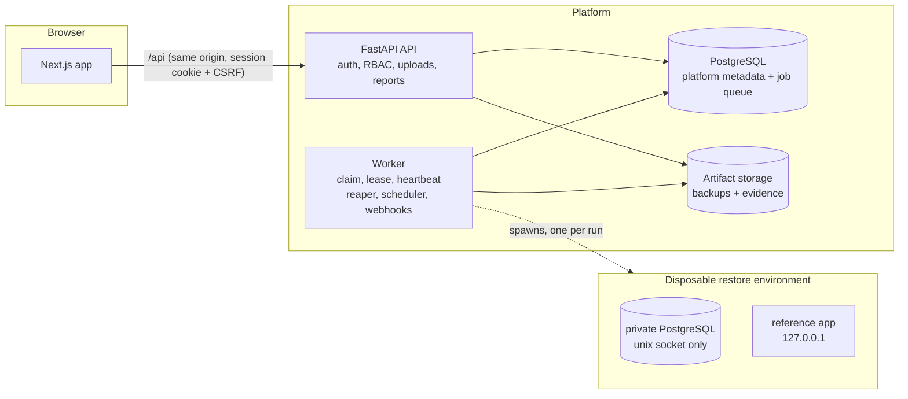

# Architecture



## Boundaries

| Concern | Where | Notes |
|---|---|---|
| Frontend and API | `web/`, `backend/afterstate/api` | Browser never talks to the worker or a restore environment. |
| Authentication and tenancy | `api/deps.py`, `security/` | Server-side sessions (hashed tokens), CSRF double-submit + Origin check, RBAC on every route, 404 for non-members. |
| Project configuration | `projects.py`, `domain/rules.py` | Rules are a validated discriminated union; the run takes an immutable snapshot (`domain/runconfig.py`). |
| Artifact storage | `storage/` | `ArtifactStorage` protocol; local filesystem implementation (ADR 0005). |
| Durable job orchestration | `worker/`, `engine/store.py` | PostgreSQL is the queue (`SKIP LOCKED`), leases with fencing, reaper (ADR 0004). |
| Isolated restore | `engine/environment.py`, `engine/restore.py` | ADR 0001, 0002. |
| Verification | `engine/inspect.py`, `engine/validators.py`, `engine/appsuite.py` | Independent of the restore's exit status. |
| Metrics and evidence | `engine/pipeline.py`, `engine/report.py` | Measured with a monotonic clock; reports built only from persisted facts. |
| Audit | `audit.py` | Actor, outcome, IP, correlation id; secrets redacted. |

Execution never depends on a browser session: the worker owns runs through leases, and the scheduler runs inside the worker.

## Run state machine

```
QUEUED -> PREPARING -> RESTORING -> VALIDATING -> FINALIZING -> SUCCEEDED | FAILED | NEEDS_ATTENTION | CANCELLED
                 any in-flight state -> NEEDS_CLEANUP -> (settled state)
```

| From | Allowed to |
|---|---|
| QUEUED | PREPARING, CANCELLED |
| PREPARING | RESTORING, FINALIZING, NEEDS_CLEANUP |
| RESTORING | VALIDATING, FINALIZING, NEEDS_CLEANUP |
| VALIDATING | FINALIZING, NEEDS_CLEANUP |
| FINALIZING | SUCCEEDED, FAILED, CANCELLED, NEEDS_ATTENTION, NEEDS_CLEANUP |
| NEEDS_CLEANUP | SUCCEEDED, FAILED, CANCELLED, NEEDS_ATTENTION (once cleanup is confirmed) |
| SUCCEEDED, FAILED, CANCELLED, NEEDS_ATTENTION | none (terminal) |

Every failure and cancellation passes through FINALIZING so evidence is written and resources are cleaned before a verdict is visible.
`NEEDS_CLEANUP` is deliberately not terminal. These rules are asserted by `tests/unit/test_domain.py` (including that the partial unique
index enforcing one queued-or-active run per project matches `SLOT_STATES`).

**Recovery of interrupted runs.** A run whose lease expires belongs to a dead worker. The reaper takes ownership (late writes from the
old worker are fenced out by `lease_owner`), marks unfinished stages, kills any orphaned PostgreSQL found through the cleanup task
recorded before it was created, settles the run as `FAILED / WORKER_INTERRUPTED`, and the retry policy queues a new attempt.
Proven with a real `SIGKILL` in `test_worker_killed_mid_restore_is_recovered_from_durable_state` and in the Recovery Lab.

## Data model

19 tables, normalized, with foreign keys, partial unique indexes and enum `CHECK` constraints (`backend/alembic/versions/0001_initial_schema.py`):
users, workspaces, memberships, sessions, backup_artifacts, artifact_verifications, recovery_projects, validation_rules, schedules,
recovery_runs, run_stages, run_events, validation_results, run_evidence, cleanup_tasks, schedule_firings, audit_events, notifications,
worker_heartbeats. Large files live in artifact storage, never in rows.
